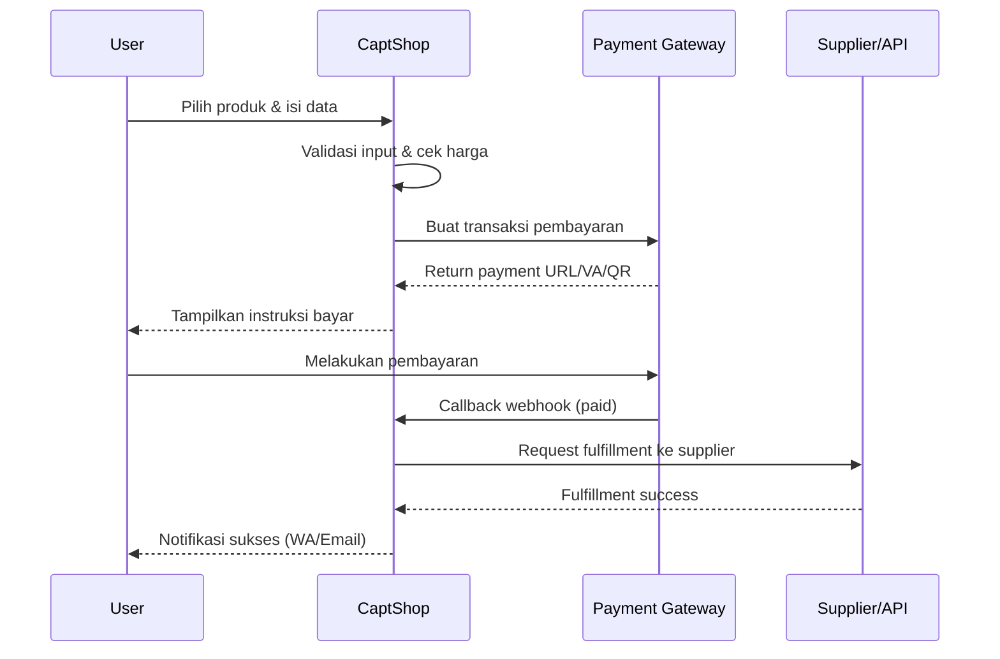
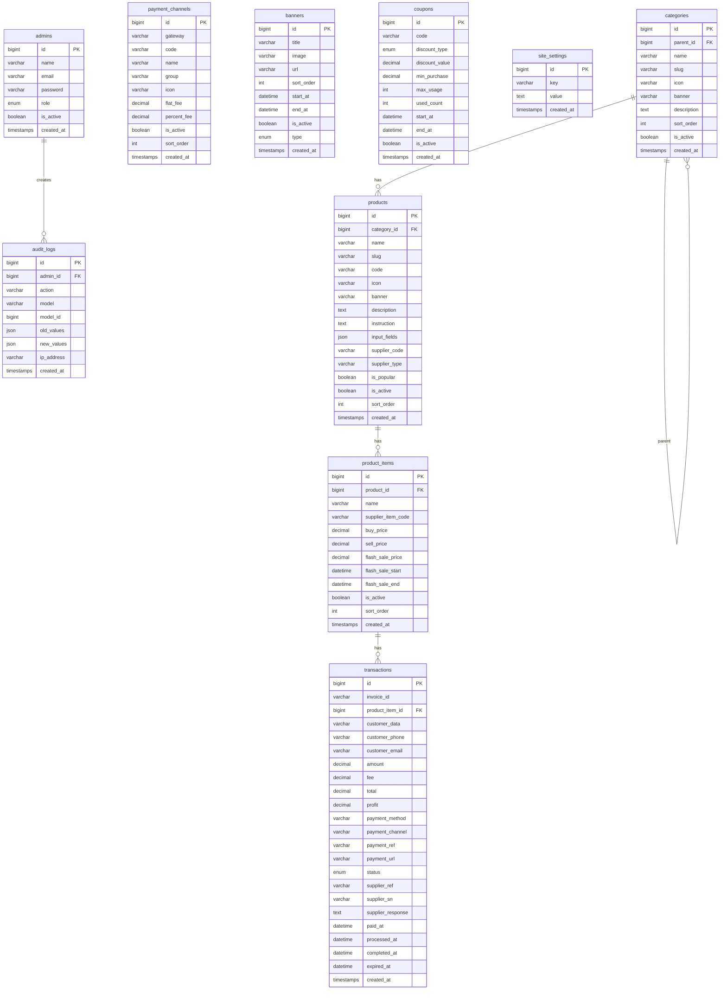

# PRD: CaptShop — Platform Top-Up Game & PPOB

## 1. Ringkasan Proyek

**CaptShop** adalah platform web untuk top-up game, voucher digital, dan pembayaran PPOB (Payment Point Online Bank) yang terinspirasi dari Codashop, OuraStore, GoatCoins, Takapedia, dan BangJeff. Platform ini memungkinkan pengguna untuk membeli voucher game, diamond, coins, pulsa, token listrik, dan produk digital lainnya dengan proses yang cepat, aman, dan tanpa perlu login.

### Tech Stack
| Komponen | Teknologi |
|---|---|
| Backend | **Laravel 11** (PHP 8.2) |
| Database | **MySQL 8.x** |
| Frontend | **Blade** + **Tailwind CSS 3.x** + **Alpine.js** |
| Bundler | **Vite** |
| Pendekatan UI | **Mobile-First Responsive** |

> [!IMPORTANT]
> Semua desain dan layout **wajib mengutamakan tampilan mobile** (mobile-first). Desktop adalah secondary viewport.

---

## 2. Analisis Kompetitor

### 2.1 Codashop (`codashop.com/id-id`)
- UI clean, dark theme, grid produk game populer
- Proses pembelian tanpa login (guest checkout)
- Flow: Pilih Game → Masukkan User ID → Pilih Nominal → Pilih Pembayaran → Bayar
- Fitur: Carousel banner promo, search, account optional, multi-bahasa/negara

### 2.2 OuraStore (`ourastore.com/id-id`)
- Kategori: Games, Entertainment, Voucher
- Flash sale section, promo highlight
- Tampilan card-based grid dengan harga dan diskon
- Social proof: jumlah transaksi, rating

### 2.3 GoatCoins (`goatcoins.id/id-id`)
- Fokus pada game mobile (ML, FF, PUBG, Genshin)
- UI modern dengan card game yang besar & visual
- Cek ID/nickname sebelum purchase
- Instant delivery, WhatsApp notification

### 2.4 Takapedia (`takapedia.com/id-id`)
- Kategori lengkap: Games, Pulsa, PLN, E-Wallet
- Fitur PPOB lengkap (listrik, BPJS, internet)
- Harga kompetitif dengan markup transparan
- Riwayat transaksi via nomor HP

### 2.5 BangJeff (`bangjeff.com/en-th`)
- Multi-country support (TH, ID, PH, MY)
- Review/rating dari pembeli
- Cashback & loyalty points
- Referral program

---

## 3. Fitur Utama

### 3.1 Halaman & Navigasi

#### 3.1.1 Homepage
- **Hero Banner Carousel** — Slider otomatis untuk promo, flash sale, event (swipeable di mobile)
- **Search Bar** — Pencarian produk/game dengan autocomplete, posisi prominent di atas
- **Kategori Grid** — Ikon kategori horizontal scrollable: Games, Pulsa, PLN, E-Wallet, Voucher, PPOB
- **Produk Populer** — Grid card game/produk paling laku, 2 kolom mobile / 4-6 kolom desktop
- **Flash Sale Section** — Produk diskon dengan countdown timer
- **Banner Promo Sekunder** — Banner mid-page untuk promo spesifik
- **Keunggulan/Trust Section** — "Mengapa CaptShop?" dengan ikon: Instan, Aman, 24/7, Harga Terbaik

#### 3.1.2 Halaman Kategori
- Filter & sort (terpopuler, terbaru, A-Z)
- Grid produk dengan lazy loading / infinite scroll
- Breadcrumb navigation

#### 3.1.3 Halaman Detail Produk / Order
> [!IMPORTANT]
> Ini adalah halaman paling kritis — flow harus seminimal mungkin (mirip Codashop: 1 halaman, tanpa login).

**Flow pembelian dalam 1 halaman (single-page checkout):**

```
┌─────────────────────────────────────┐
│  🎮 Mobile Legends: Bang Bang       │
│  [Banner Game]                       │
│                                      │
│  STEP 1: Masukkan Data              │
│  ┌────────────────────────────────┐ │
│  │ User ID: [__________]          │ │
│  │ Server:  [__________]          │ │
│  │ [✓ Cek Nickname: "PlayerXYZ"]  │ │
│  └────────────────────────────────┘ │
│                                      │
│  STEP 2: Pilih Nominal              │
│  ┌──────┐ ┌──────┐ ┌──────┐       │
│  │  86  │ │ 172  │ │ 257  │       │
│  │ Dias │ │ Dias │ │ Dias │       │
│  │Rp15k │ │Rp30k │ │Rp44k │       │
│  └──────┘ └──────┘ └──────┘       │
│  ┌──────┐ ┌──────┐ ┌──────┐       │
│  │ 344  │ │ 514  │ │ 706  │       │
│  │ Dias │ │ Dias │ │ Dias │       │
│  │Rp59k │ │Rp87k │ │Rp119k│       │
│  └──────┘ └──────┘ └──────┘       │
│                                      │
│  STEP 3: Pilih Pembayaran           │
│  ┌────────────────────────────────┐ │
│  │ 💳 Transfer Bank               │ │
│  │   BCA | BNI | BRI | Mandiri   │ │
│  ├────────────────────────────────┤ │
│  │ 📱 E-Wallet                    │ │
│  │   DANA | OVO | GoPay | ShopeePay│
│  ├────────────────────────────────┤ │
│  │ 🏪 Retail / Convenience Store  │ │
│  │   Alfamart | Indomaret         │ │
│  ├────────────────────────────────┤ │
│  │ 💰 QRIS                        │ │
│  └────────────────────────────────┘ │
│                                      │
│  STEP 4: Kontak                     │
│  ┌────────────────────────────────┐ │
│  │ No. WhatsApp: [___________]    │ │
│  │ Email (opsional): [________]   │ │
│  └────────────────────────────────┘ │
│                                      │
│  ┌────────────────────────────────┐ │
│  │ Ringkasan:                     │ │
│  │ 86 Diamonds — Rp 15.000       │ │
│  │ Biaya layanan — Rp 1.000      │ │
│  │ Total: Rp 16.000              │ │
│  │                                │ │
│  │ [    🛒 BELI SEKARANG    ]    │ │
│  └────────────────────────────────┘ │
└─────────────────────────────────────┘
```

#### 3.1.4 Halaman Invoice / Status Pembayaran
- Detail pesanan & instruksi pembayaran
- QR Code (untuk QRIS)
- Virtual Account number (untuk bank transfer)
- Countdown timer batas pembayaran
- Status: Menunggu Pembayaran → Diproses → Berhasil / Gagal
- Tombol "Cek Status" tanpa login (via invoice ID + nomor HP)
- Kirim notifikasi via WhatsApp & Email

#### 3.1.5 Halaman Cek Transaksi
- Input: Invoice ID / Nomor HP
- Output: Status transaksi, detail pesanan, bukti pembayaran

#### 3.1.6 Halaman Statis
- Tentang Kami
- Syarat & Ketentuan
- Kebijakan Privasi
- FAQ / Pusat Bantuan
- Kontak

---

### 3.2 Kategori Produk

#### 3.2.1 Top-Up Games
| Game | Produk |
|---|---|
| Mobile Legends | Diamonds, Starlight, Twilight Pass |
| Free Fire | Diamonds, Membership |
| PUBG Mobile | UC (Unknown Cash) |
| Genshin Impact | Genesis Crystals, Welkin Moon |
| Honkai: Star Rail | Oneiric Shard |
| Valorant | VP (Valorant Points) |
| Call of Duty Mobile | CP (COD Points) |
| Roblox | Robux |
| Steam | Steam Wallet Code |
| Dan lainnya... | (Dinamis via admin panel) |

#### 3.2.2 Voucher Digital
- Google Play Gift Card
- iTunes / App Store Gift Card
- PlayStation Store
- Xbox / Game Pass
- Netflix, Spotify, YouTube Premium
- Discord Nitro

#### 3.2.3 Pulsa & Paket Data
- Telkomsel, Indosat, XL, Tri, Smartfren, Axis
- Paket Data / Internet
- Paket Telepon & SMS

#### 3.2.4 PPOB (Payment Point Online Bank)
- Token Listrik PLN (Prepaid)
- Tagihan Listrik PLN (Postpaid)
- PDAM / Air
- BPJS Kesehatan
- Internet / WiFi (IndiHome, Biznet, MyRepublic)
- TV Kabel (Transvision, K-Vision)
- Cicilan (Akulaku, Kredivo)
- PBB (Pajak Bumi & Bangunan)

#### 3.2.5 E-Wallet Top-Up
- DANA
- OVO
- GoPay
- ShopeePay
- LinkAja

---

### 3.3 Sistem Pembayaran (Payment Gateway)

> [!NOTE]
> Integrasi menggunakan **Tripay** dan/atau **Midtrans** sebagai payment gateway utama. Arsitektur mendukung multi-gateway untuk fallback.

**Metode yang didukung:**

| Kategori | Channel |
|---|---|
| Virtual Account | BCA, BNI, BRI, Mandiri, Permata, CIMB |
| E-Wallet | DANA, OVO, GoPay, ShopeePay, LinkAja |
| Retail | Alfamart, Indomaret |
| QRIS | Universal QRIS |
| Kartu | Visa, Mastercard (opsional fase 2) |

**Flow Pembayaran:**


---

### 3.4 Panel Admin (Dashboard)

#### 3.4.1 Dashboard Overview
- Total transaksi hari ini / minggu / bulan
- Revenue & profit chart
- Transaksi pending / gagal yang butuh tindakan
- Top produk terlaris
- Grafik tren penjualan (line/bar chart)

#### 3.4.2 Manajemen Produk
- CRUD Kategori (parent & child)
- CRUD Game / Produk
  - Nama, slug, deskripsi, ikon/banner
  - Input fields konfigurasi (User ID, Server, dll — dinamis per game)
  - Status aktif/nonaktif
- CRUD Item / SKU per Produk
  - Nama item, nominal, harga beli (dari supplier), harga jual, margin
  - Flash sale price + jadwal
  - Status stok

#### 3.4.3 Manajemen Transaksi
- List semua transaksi dengan filter (status, tanggal, produk, metode bayar)
- Detail transaksi lengkap
- Manual action: retry fulfillment, refund, mark as completed
- Export CSV/Excel

#### 3.4.4 Manajemen Pembayaran
- Setting payment gateway (API keys, webhook URL)
- Enable/disable metode pembayaran
- Setting biaya layanan per channel
- Log webhook & callback

#### 3.4.5 Manajemen Banner & Promo
- CRUD banner carousel (gambar, link, urutan, jadwal tayang)
- CRUD flash sale (produk, harga promo, jadwal mulai/selesai)
- Kupon diskon (kode, persentase/nominal, min. pembelian, masa berlaku, kuota)

#### 3.4.6 Manajemen User Admin
- Multi-role: Super Admin, Admin, Operator, CS
- Audit log aktivitas admin

#### 3.4.7 Pengaturan Umum
- Nama situs, logo, favicon, deskripsi SEO
- Kontak (WhatsApp, email, sosial media)
- Template notifikasi (WhatsApp & Email)
- Maintenance mode

---

### 3.5 Fitur Pendukung

#### 3.5.1 Notifikasi
- **WhatsApp** (via Fonnte/WooWA/WA Gateway) — notifikasi pembelian, status transaksi
- **Email** (via SMTP / Mailtrap / Mailgun) — invoice, receipt, promo

#### 3.5.2 SEO & Performance
- Meta tags dinamis per halaman (title, description, OG tags)
- Sitemap XML otomatis
- Schema.org markup (Product, BreadcrumbList)
- Image optimization & lazy loading
- Minified CSS/JS via Vite
- Server-side caching (Redis opsional)

#### 3.5.3 Keamanan
- CSRF protection (Laravel built-in)
- Rate limiting pada order API
- Input sanitization & validation
- Webhook signature verification
- Admin 2FA (opsional fase 2)
- IP whitelist untuk webhook endpoint

#### 3.5.4 Integrasi Supplier / Provider
- **DigiFlazz** — untuk top-up game, pulsa, PPOB
- **Apigames / VocaGame** — alternatif supplier game
- **MobilePulsa / IAK** — alternatif PPOB
- Arsitektur multi-supplier dengan fallback otomatis
- Cek saldo supplier dari dashboard

---

## 4. Arsitektur & Struktur Database

### 4.1 ERD (Entity Relationship Diagram)



### 4.2 Kolom `input_fields` (JSON) — Konfigurasi Dinamis

Setiap game/produk memerlukan input yang berbeda. Kolom `input_fields` menyimpan konfigurasi form dinamis:

```json
// Mobile Legends
[
  { "name": "user_id", "label": "User ID", "type": "text", "required": true, "placeholder": "Contoh: 12345678" },
  { "name": "zone_id", "label": "Zone ID", "type": "text", "required": true, "placeholder": "Contoh: 1234" }
]

// Free Fire
[
  { "name": "user_id", "label": "Player ID", "type": "text", "required": true, "placeholder": "Masukkan Player ID" }
]

// PLN Prepaid
[
  { "name": "customer_id", "label": "Nomor Meter / ID Pelanggan", "type": "text", "required": true, "placeholder": "Contoh: 1234567890" }
]

// Pulsa
[
  { "name": "phone", "label": "Nomor HP", "type": "tel", "required": true, "placeholder": "08xxxxxxxxxx" }
]
```

### 4.3 Struktur Laravel Directory

```
captshopnew/
├── app/
│   ├── Http/
│   │   ├── Controllers/
│   │   │   ├── Frontend/
│   │   │   │   ├── HomeController.php
│   │   │   │   ├── ProductController.php
│   │   │   │   ├── OrderController.php
│   │   │   │   ├── InvoiceController.php
│   │   │   │   └── TrackController.php
│   │   │   ├── Admin/
│   │   │   │   ├── DashboardController.php
│   │   │   │   ├── CategoryController.php
│   │   │   │   ├── ProductController.php
│   │   │   │   ├── ProductItemController.php
│   │   │   │   ├── TransactionController.php
│   │   │   │   ├── BannerController.php
│   │   │   │   ├── CouponController.php
│   │   │   │   ├── PaymentChannelController.php
│   │   │   │   ├── SettingController.php
│   │   │   │   └── AdminController.php
│   │   │   └── Webhook/
│   │   │       ├── TripayController.php
│   │   │       └── MidtransController.php
│   │   ├── Middleware/
│   │   │   ├── AdminAuth.php
│   │   │   ├── VerifyWebhookSignature.php
│   │   │   └── ThrottleOrders.php
│   │   └── Requests/
│   │       ├── OrderRequest.php
│   │       └── Admin/
│   ├── Models/
│   │   ├── Category.php
│   │   ├── Product.php
│   │   ├── ProductItem.php
│   │   ├── Transaction.php
│   │   ├── PaymentChannel.php
│   │   ├── Banner.php
│   │   ├── Coupon.php
│   │   ├── SiteSetting.php
│   │   ├── Admin.php
│   │   └── AuditLog.php
│   ├── Services/
│   │   ├── Payment/
│   │   │   ├── PaymentGatewayInterface.php
│   │   │   ├── TripayService.php
│   │   │   └── MidtransService.php
│   │   ├── Supplier/
│   │   │   ├── SupplierInterface.php
│   │   │   ├── DigiflazzService.php
│   │   │   └── ApigamesService.php
│   │   ├── Notification/
│   │   │   ├── WhatsAppService.php
│   │   │   └── EmailService.php
│   │   └── OrderService.php
│   └── Enums/
│       ├── TransactionStatus.php
│       ├── PaymentGateway.php
│       └── AdminRole.php
├── database/
│   ├── migrations/
│   └── seeders/
├── resources/
│   └── views/
│       ├── layouts/
│       │   ├── app.blade.php          (frontend layout)
│       │   └── admin.blade.php        (admin layout)
│       ├── frontend/
│       │   ├── home.blade.php
│       │   ├── category.blade.php
│       │   ├── product.blade.php      (detail + order form)
│       │   ├── invoice.blade.php
│       │   ├── track.blade.php
│       │   └── pages/
│       │       ├── about.blade.php
│       │       ├── faq.blade.php
│       │       ├── terms.blade.php
│       │       └── privacy.blade.php
│       ├── admin/
│       │   ├── dashboard.blade.php
│       │   ├── categories/
│       │   ├── products/
│       │   ├── transactions/
│       │   ├── banners/
│       │   ├── coupons/
│       │   └── settings/
│       ├── components/
│       │   ├── hero-carousel.blade.php
│       │   ├── category-grid.blade.php
│       │   ├── product-card.blade.php
│       │   ├── flash-sale.blade.php
│       │   ├── payment-selector.blade.php
│       │   ├── order-summary.blade.php
│       │   └── trust-section.blade.php
│       └── emails/
│           ├── invoice.blade.php
│           └── receipt.blade.php
├── routes/
│   ├── web.php
│   ├── admin.php
│   └── webhook.php
└── config/
    ├── payment.php
    └── supplier.php
```

---

## 5. Desain UI / UX

### 5.1 Design System

| Aspek | Spesifikasi |
|---|---|
| Primary Color | `#6C3CE1` (Purple/Ungu — brand identity) |
| Secondary Color | `#10B981` (Green — success/CTA) |
| Accent Color | `#F59E0B` (Amber — flash sale/promo) |
| Background | `#0F172A` (Dark Slate — dark mode utama) |
| Surface/Card | `#1E293B` (Slate 800) |
| Text Primary | `#F1F5F9` (Slate 100) |
| Text Secondary | `#94A3B8` (Slate 400) |
| Font | **Inter** (body) / **Poppins** (heading) |
| Border Radius | `12px` (cards) / `8px` (buttons/inputs) |
| Mode | **Dark mode default** (sesuai tren kompetitor) |

### 5.2 Mobile-First Breakpoints

```css
/* Base: Mobile (< 640px) — DEFAULT */
/* sm: ≥ 640px — Large phones */
/* md: ≥ 768px — Tablets */
/* lg: ≥ 1024px — Desktop */
/* xl: ≥ 1280px — Large desktop (max-width container) */
```

### 5.3 Wireframe Alur Mobile

#### Homepage Mobile
```
┌──────────────────────────┐
│ 🔍 [  Cari game...   ]  │  ← Sticky search bar
│ [Logo]         [≡ Menu]  │
├──────────────────────────┤
│ ┌──────────────────────┐ │
│ │   HERO CAROUSEL      │ │  ← Full-width banner swipe
│ │   🔴 ● ○ ○ ○        │ │
│ └──────────────────────┘ │
├──────────────────────────┤
│ 🎮 Games  📱 Pulsa      │  ← Horizontal scroll kategori
│ ⚡ PLN   💰 E-Wallet    │
│ 🎫 Voucher 📺 PPOB     │
├──────────────────────────┤
│ 🔥 Flash Sale    [Lihat]│
│ ⏰ 02:34:15              │
│ ┌─────┐ ┌─────┐ ┌─────┐│
│ │ ML  │ │ FF  │ │PUBG ││  ← Horizontal scroll
│ │-20% │ │-15% │ │-10% ││
│ └─────┘ └─────┘ └─────┘│
├──────────────────────────┤
│ ⭐ Produk Populer        │
│ ┌──────┐ ┌──────┐       │
│ │  ML  │ │  FF  │       │  ← 2-column grid
│ │ Bang │ │ Max  │       │
│ │ Bang │ │      │       │
│ └──────┘ └──────┘       │
│ ┌──────┐ ┌──────┐       │
│ │PUBG  │ │Genshin│      │
│ │Mobile│ │Impact │      │
│ └──────┘ └──────┘       │
├──────────────────────────┤
│ 🏆 Mengapa CaptShop?    │
│ ⚡ Proses Instan         │
│ 🔒 Pembayaran Aman      │
│ 💬 CS 24/7               │
│ 💰 Harga Terbaik         │
├──────────────────────────┤
│ [Footer]                 │
│ Tentang | FAQ | Kontak   │
│ © 2026 CaptShop          │
└──────────────────────────┘
```

#### Bottom Navigation (Mobile Fixed)
```
┌──────────────────────────────┐
│  🏠 Home  🔍 Cari  📋 Cek  │  ← Fixed bottom bar
│                    Transaksi │
└──────────────────────────────┘
```

---

## 6. Routing

### 6.1 Frontend Routes

| Method | URI | Controller | Keterangan |
|---|---|---|---|
| GET | `/` | `HomeController@index` | Homepage |
| GET | `/kategori/{slug}` | `ProductController@category` | Halaman kategori |
| GET | `/{category}/{slug}` | `ProductController@show` | Detail & order produk |
| POST | `/order` | `OrderController@store` | Submit order |
| GET | `/invoice/{id}` | `InvoiceController@show` | Status invoice |
| POST | `/invoice/{id}/check-status` | `InvoiceController@checkStatus` | Cek status pembayaran |
| GET | `/cek-transaksi` | `TrackController@index` | Form cek transaksi |
| POST | `/cek-transaksi` | `TrackController@search` | Hasil cek transaksi |
| GET | `/tentang-kami` | `PageController@about` | Tentang Kami |
| GET | `/faq` | `PageController@faq` | FAQ |
| GET | `/syarat-ketentuan` | `PageController@terms` | S&K |
| GET | `/kebijakan-privasi` | `PageController@privacy` | Privasi |

### 6.2 Admin Routes (prefix: `/admin`)

| Method | URI | Controller | Keterangan |
|---|---|---|---|
| GET | `/admin/login` | `AuthController@loginForm` | Login admin |
| POST | `/admin/login` | `AuthController@login` | Process login |
| GET | `/admin/dashboard` | `DashboardController@index` | Dashboard |
| Resource | `/admin/categories` | `CategoryController` | CRUD kategori |
| Resource | `/admin/products` | `ProductController` | CRUD produk |
| Resource | `/admin/product-items` | `ProductItemController` | CRUD item/SKU |
| Resource | `/admin/transactions` | `TransactionController` | List & manage |
| Resource | `/admin/banners` | `BannerController` | CRUD banner |
| Resource | `/admin/coupons` | `CouponController` | CRUD kupon |
| Resource | `/admin/payment-channels` | `PaymentChannelController` | Payment config |
| Resource | `/admin/settings` | `SettingController` | Site settings |
| Resource | `/admin/admins` | `AdminController` | User admin |

### 6.3 Webhook Routes (prefix: `/webhook`)

| Method | URI | Controller |
|---|---|---|
| POST | `/webhook/tripay` | `TripayController@handle` |
| POST | `/webhook/midtrans` | `MidtransController@handle` |

---

## 7. API Integrations

### 7.1 Payment Gateway — Tripay

```php
// config/payment.php
return [
    'tripay' => [
        'api_key' => env('TRIPAY_API_KEY'),
        'private_key' => env('TRIPAY_PRIVATE_KEY'),
        'merchant_code' => env('TRIPAY_MERCHANT_CODE'),
        'base_url' => env('TRIPAY_BASE_URL', 'https://tripay.co.id/api'),
        'callback_url' => env('TRIPAY_CALLBACK_URL'),
    ],
];
```

### 7.2 Supplier — DigiFlazz

```php
// config/supplier.php
return [
    'digiflazz' => [
        'username' => env('DIGIFLAZZ_USERNAME'),
        'api_key' => env('DIGIFLAZZ_API_KEY'),
        'base_url' => 'https://api.digiflazz.com/v1',
    ],
];
```

---

## 8. Rencana Implementasi (Fase)

### Fase 1 — MVP (Minggu 1-3)
- [x] Setup Laravel 11 project + Tailwind + Vite
- [ ] Database migration & models
- [ ] Admin authentication & dashboard layout
- [ ] CRUD: Categories, Products, Product Items
- [ ] Homepage frontend (carousel, kategori, produk populer)
- [ ] Halaman detail produk & form order
- [ ] Integrasi payment gateway (Tripay)
- [ ] Integrasi supplier (DigiFlazz)
- [ ] Invoice & status pembayaran
- [ ] Webhook handler
- [ ] Cek transaksi

### Fase 2 — Fitur Lanjutan (Minggu 4-5)
- [ ] Flash sale & countdown timer
- [ ] Kupon diskon
- [ ] Notifikasi WhatsApp
- [ ] Notifikasi Email (invoice & receipt)
- [ ] Banner management
- [ ] SEO optimization (meta, sitemap, schema)
- [ ] Admin dashboard charts & analytics

### Fase 3 — Polish & Optimasi (Minggu 6)
- [ ] Performance optimization (cache, lazy load)
- [ ] Security hardening (rate limit, 2FA admin)
- [ ] User testing & bug fixes
- [ ] Multi-supplier fallback
- [ ] Export laporan (CSV/Excel)
- [ ] PWA support (opsional)

---

## 9. Non-Functional Requirements

| Aspek | Target |
|---|---|
| Response Time | < 2 detik (halaman utama) |
| Uptime | 99.5% |
| Mobile Score (Lighthouse) | > 85 |
| Concurrent Users | Minimal 500 |
| Browser Support | Chrome, Safari, Firefox (2 versi terakhir) |
| PHP Version | 8.2+ |
| MySQL Version | 8.0+ |
| Laravel Version | 11.x |

---

## 10. Deployment Requirements

| Komponen | Rekomendasi |
|---|---|
| Server | VPS (2 vCPU, 4GB RAM minimum) |
| OS | Ubuntu 22.04 LTS |
| Web Server | Nginx |
| PHP | 8.2 via php-fpm |
| SSL | Let's Encrypt (Certbot) |
| Queue | Laravel Queue + Supervisor (untuk webhook processing) |
| Cache | Redis (opsional, file cache untuk MVP) |
| Storage | Local disk + CDN (opsional) |
| Backup | Daily automated MySQL dump |

---

## Open Questions

> [!IMPORTANT]
> Mohon review dan jawab pertanyaan berikut sebelum memulai implementasi:

1. **Nama Brand**: Apakah "CaptShop" sudah fix, atau ada nama lain yang diinginkan?

2. **Payment Gateway**: Prefer **Tripay** atau **Midtrans**? Atau keduanya dari awal? Apakah sudah punya akun?

3. **Supplier**: Prefer **DigiFlazz** atau supplier lain? Apakah sudah punya akun API?

4. **Notifikasi WhatsApp**: Apakah sudah punya layanan WA Gateway (Fonnte, WooWA, dll)?

5. **Color Scheme**: Apakah setuju dengan dark theme purple-based? Atau ada preferensi warna lain?

6. **Bahasa**: Apakah website hanya dalam Bahasa Indonesia, atau perlu multi-bahasa?

7. **Fitur User Account**: Apakah user/customer perlu bisa register & login (untuk riwayat order, favorit, dll), atau murni guest checkout saja seperti Codashop?

8. **Hosting**: Sudah punya VPS/server? Atau perlu rekomendasi?

---

## Verification Plan

### Automated Tests
- `php artisan test` — Unit tests untuk OrderService, PaymentService, SupplierService
- Feature tests untuk setiap flow (order, payment callback, invoice check)
- `npm run build` — Memastikan asset compilation berhasil

### Manual Verification
- Test flow pembelian end-to-end di staging (sandbox mode payment gateway)
- Test responsif di berbagai device (Chrome DevTools mobile simulation)
- Lighthouse performance audit
- Test webhook handling dengan request manual
